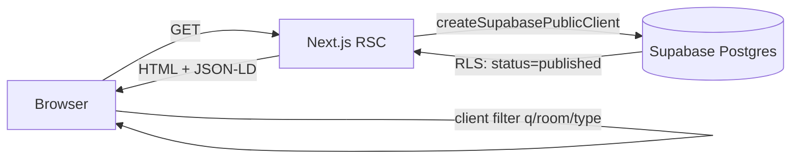
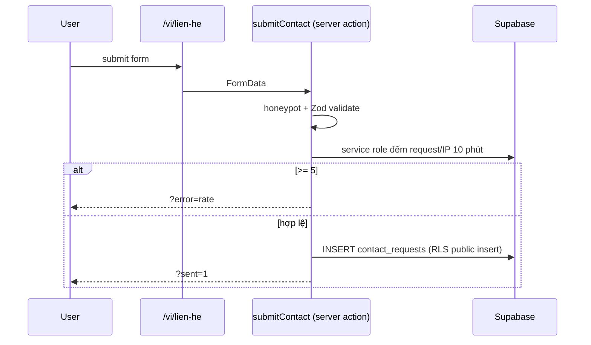
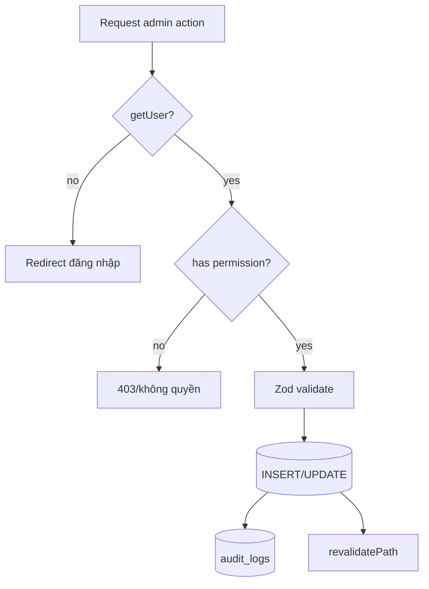
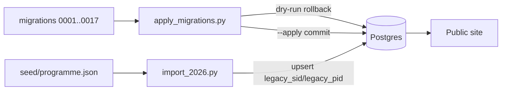

# DATA FLOW — VSOT Demo Ver 2

## 1. Public read



- Không gửi cookie người dùng khi đọc public → không thấy draft, cache an toàn.
- Truy vấn programme gom 1 lần: conference, dates, rooms, types, sessions kèm
  translations/people/presentations.
- Faculty lấy toàn bộ người của conference (quy mô nhỏ), lọc client-side.

## 2. Programme filtering

```mermaid
sequenceDiagram
  participant B as Browser
  participant P as chuong-trinh page
  participant C as ProgrammeResults (client)
  B->>P: ?date=2026-10-13&view=grid&q=ghép&room=&type=
  P->>P: SSR sessions theo date
  P->>C: sessions + filters ban đầu
  C->>C: filter q/room/type trong useMemo
  C->>B: history.replaceState cập nhật URL
  Note over C: date/view do server xử lý; filter giữ khi đổi view/ngày
```

## 3. Contact form



## 4. Admin mutation



## 5. Import/migration flow



## 6. SEO flow

- `app/sitemap.ts` đọc conference published từ public client, sinh URL VI/EN.
- `app/robots.ts` chặn admin/api/login, trỏ sitemap.
- JSON-LD chèn ở layout (Organization), landing hội nghị/phiên (Event), profile (Person).
- Metadata canonical/hreflang/OG sinh theo `params` từng trang.
