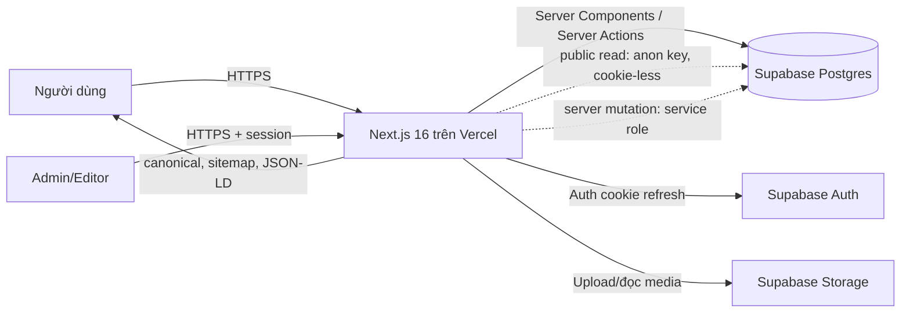
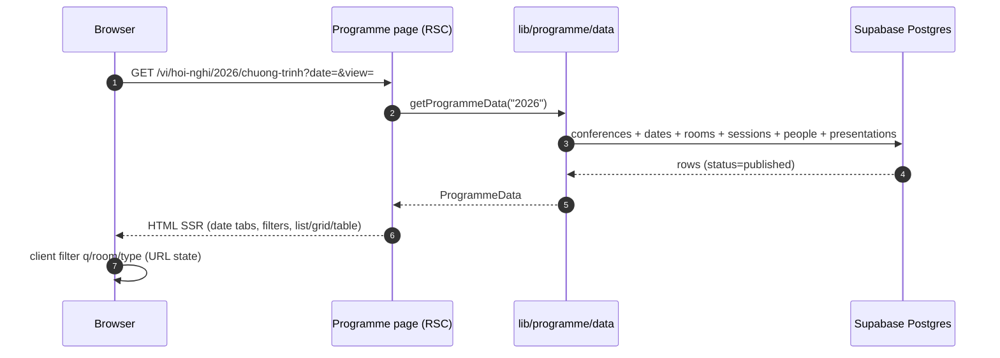
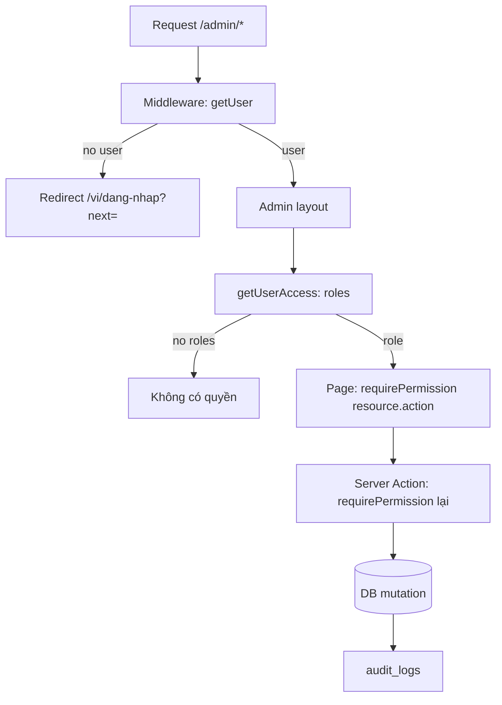
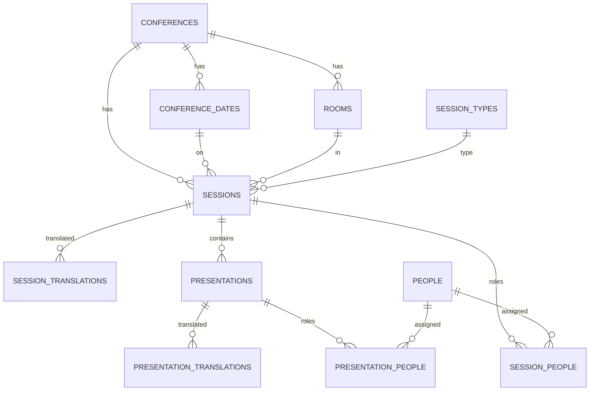

# SYSTEM ARCHITECTURE — VSOT Demo Ver 2

## 1. Stack

| Lớp | Công nghệ | Ghi chú |
|---|---|---|
| Frontend/SSR | Next.js 16.4.6 App Router | Server Components mặc định |
| UI | React 19.3.1 + Tailwind CSS 4.3.5 | Token CSS-first, không UI kit |
| Language | TypeScript 5.9 strict | |
| Auth | Supabase Auth | admin/editor; không public signup |
| DB | Supabase Postgres 17 | project `yrvhrsztcxfhlxsxbzhv` |
| Storage | Supabase Storage | bucket public/private (kế thừa migration 0011) |
| Deploy | Vercel | Preview khi được duyệt |
| Source | GitHub `nhuanphat200328/vsotrebuild2` | |

## 2. Sơ đồ container



## 3. Phân lớp code

```
app/
  [locale]/                 public shell + pages
    hoi-nghi/[year]/        landing, programme, tong-quan, phien, dien-gia
    tin-tuc, lien-he, [slug]
  admin/                    CMS (RBAC)
  api/health, api/auth/signout
components/
  layout/                   header, footer
  programme/                list, grid, table, results, role badge
  faculty/                  directory
  ui/                       container, json-ld
lib/
  supabase/                 server (cookies), public (no cookies), admin (service role), client
  programme/, faculty/, news/, pages/   data access
  auth/                     access, require, next-path
  utils/                    cn, dates, search, seo
supabase/
  migrations/               0001..0017
  seed/2026/programme.json
scripts/                    apply_migrations.py, import_2026.py
```

Nguyên tắc:
- Public read dùng `createSupabasePublicClient()` (không cookie) → không lộ draft cho admin đang đăng nhập.
- Admin read/write dùng server client có cookie + RBAC; service role chỉ dùng trong action đặc quyền
  (contact rate-limit, bootstrap đã xoá).
- UI không truy vấn DB trực tiếp; mọi truy vấn nằm trong `lib/*`.

## 4. Luồng render programme



## 5. Luồng xác thực & phân quyền



## 6. Mô hình dữ liệu (tóm tắt)



## 7. Security model

- RLS bật toàn bộ bảng public; anon chỉ SELECT dữ liệu published.
- `SUPABASE_SERVICE_ROLE_KEY` chỉ server, không prefix `NEXT_PUBLIC_`.
- Server action kiểm quyền độc lập với layout.
- Form liên hệ: Zod, honeypot, rate limit DB theo IP, lưu DB trước khi báo thành công.
- Header: `X-Content-Type-Options`, `X-Frame-Options`, `Referrer-Policy`,
  `Permissions-Policy`, `HSTS`. Chưa bật CSP nghiêm vì Next inline runtime; ghi ở backlog.
- Endpoint bootstrap super-admin đã xoá.

## 8. Deployment

- Build `next build`; migrations chạy thủ công bằng script có dry-run.
- Preview cần env riêng và `NEXT_PUBLIC_SITE_URL` đúng domain preview.
- Không chạy migration/import tự động trong CI/Vercel.

## 9. Quan sát & vận hành

- `/api/health` trả trạng thái cấu hình env (không lộ giá trị).
- Log lỗi server mặc định của Next/Vercel; audit log DB cho mutation CMS.
- Sao lưu DB theo chính sách Supabase trước thao tác dữ liệu lớn.
