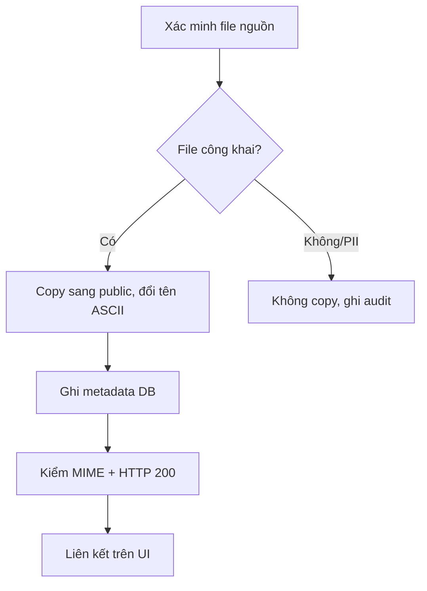

# ASSET MIGRATION PLAN

## 1. Phân loại

| Nhóm | Định nghĩa | Nơi lưu |
|---|---|---|
| A — Tĩnh | Logo, KV, template, thư mời, PDF/JPG cố định, site archive | `public/media/2026/...`, `public/legacy/...` |
| B — Quản lý | Tin tức, danh mục, metadata tài liệu, năm hội nghị | Supabase Postgres |

Không lưu file nhị phân trong cột DB.

## 2. File sẽ copy

| Nguồn | Đích | Kích thước |
|---|---|---:|
| `hoinghi2026/materials/KV.png` | `public/media/2026/kv.png` | 1,6 MB |
| `hoinghi2026/asset/logo1507104171.gif` | `public/media/2026/logo.gif` | 8 KB |
| 3 template PPTX | `public/media/2026/templates/` | 26,1 MB |
| Thư mời PDF + Gala JPG | `public/media/2026/invitations/` | 12,0 MB |
| Abstract tổng hợp PDF | `public/media/2026/documents/` | 6,4 MB |
| Chương trình khung + Record VN | `public/media/2026/news/` | 0,9 MB |
| 6 năm archive | `public/legacy/<year>/` | 39,6 MB |

## 3. Không copy

- 312 `.docx` abstract cá nhân (60 MB, PII, trùng PDF tổng hợp).
- 132 HTML abstract cá nhân (4,7 MB) — đã có trong PDF tổng hợp.
- 7 `.xlsx` nội bộ, `reports/*.csv`, `tools/*.py`, `admin/`, `backup/`.
- PDF agenda 38 MB (`4.1Final...`) — dữ liệu chương trình đã ở DB.
- `legacy/2026` 151,7 MB — hội nghị hiện tại có route native.

## 4. Quy trình

## 5. Quy tắc

- Không sửa nội dung file gốc.
- Tên file đích ASCII, không khoảng trắng, không dấu tiếng Việt.
- Mỗi tài liệu có: tiêu đề VI/EN, mô tả, loại, năm, đường dẫn, định dạng, thứ tự, trạng thái.
- Kiểm MIME khi tải; PDF `application/pdf`, PPTX đúng
  `application/vnd.openxmlformats-officedocument.presentationml.presentation`, JPG `image/jpeg`.
- Không để đường dẫn phụ thuộc `vsot.com.vn` sau khi đã có bản lưu.
- Không đưa file vào git nếu chứa dữ liệu cá nhân chưa được phép.

## 6. Kết quả mong đợi

- Tổng dung lượng thêm: khoảng 84,6 MB (`media` 45 MB + `legacy` 39,6 MB).
- Tất cả tài liệu trên trang chủ mở/tải được từ domain mới.
- Metadata tài liệu truy vấn được từ DB, không hardcode component.
