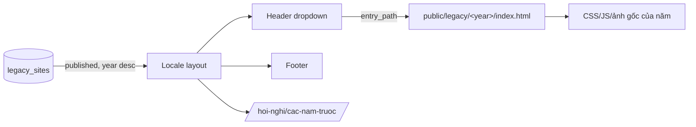

# CONFERENCE ARCHIVE PLAN

## 1. Nguồn và phạm vi

- Chỉ đọc: `2027 demo/public/legacy/{2018,2019,2021,2022,2023,2025}`.
- 2026 là hội nghị hiện tại, có route riêng, không nằm trong dropdown "Hội nghị các năm".
- Không có 2020 và 2024 trong nguồn → không tạo link/năm giả.
- 2021 và 2023 chỉ có trang `index.html`; 2022 có chương trình đầy đủ + phụ lục; 2025 có
  CTKH.pdf + 300+ ảnh gallery.

## 2. Cách lưu trữ

Đã copy nguyên thư mục năm sang `public/legacy/<year>/` (39,6 MB, 390 file), giữ nguyên
HTML/CSS/JS/ảnh gốc, không sửa nội dung. Middleware bỏ qua path có dấu chấm nên file tĩnh
được phục vụ trực tiếp, không qua locale redirect.

Metadata lưu DB bảng `legacy_sites` (6 dòng published):

| slug | year | entry_path | status |
|---|---:|---|---|
| 2025 | 2025 | `/legacy/2025/index.html` | published |
| 2023 | 2023 | `/legacy/2023/index.html` | published |
| 2022 | 2022 | `/legacy/2022/index.html` | published |
| 2021 | 2021 | `/legacy/2021/index.html` | published |
| 2019 | 2019 | `/legacy/2019/index.html` | published |
| 2018 | 2018 | `/legacy/2018/index.html` | published |

## 3. UI

- Header desktop: mục "Hội nghị các năm" + dropdown, sort mới nhất trước, hover/click,
  `aria-expanded`, `aria-controls`.
- Mobile: accordion trong menu, tap mở/đóng; dock giữ 5 mục chính.
- Footer: 4 năm gần nhất + link kho lưu trữ.
- Trang `/[locale]/hoi-nghi/cac-nam-truoc`: danh sách năm, mô tả, nút mở bản lưu trữ.
- Trang chủ: dải số năm 2/3/6 cột theo breakpoint.

## 4. Luồng dữ liệu

## 5. Kiểm thử

- `/legacy/2025/index.html`, `/legacy/2022/full-programme.htm`,
  `/legacy/2019/index.html`, `/legacy/2021/index.html`, `/legacy/2023/index.html` → 200.
- `/legacy/2025/pictures/25-1.jpg`, `/legacy/2025/CTKH.pdf` → 200.
- Header HTML chứa danh sách năm; trang archive render 6 mục.
- Không kiểm bằng mắt trên trình duyệt thật (xem TESTING_REPORT).

## 6. Hạn chế

- Các site archive có header/footer/theme cũ, khác giao diện mới — chấp nhận vì mục tiêu bảo toàn.
- 2018/2019 không có ảnh; 2021/2023 rất mỏng; đã ghi rõ trong audit, không cố tạo nội dung.
- 2020/2024 chưa có nguồn.
