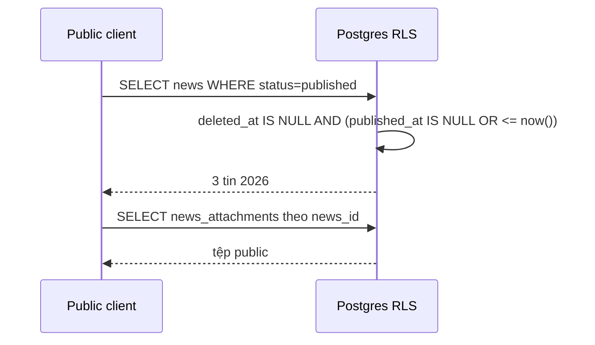

# DATABASE UPDATE PLAN

## 1. Audit trước thay đổi

- Supabase project `yrvhrsztcxfhlxsxbzhv`; 35 bảng public, 94 RLS policy, 3 bucket.
- `conference_documents` đã có `media_id` nullable nhưng thiếu đường dẫn file trực tiếp.
- `news` có `cover_media_id`; chưa có bảng tệp đính kèm.
- `legacy_sites` có sẵn cấu trúc cho archive.
- Không có bảng nào trùng chức năng cần tạo mới ngoài `news_attachments`.

## 2. Migration

| File | Thay đổi | Loại |
|---|---|---|
| `0018_content_assets_archive.sql` | Thêm `file_path`, `file_format`, `description_vi/en` cho `conference_documents`; tạo `news_attachments`; RLS | Mở rộng, idempotent |
| `0019_seed_content_2026.sql` | 3 danh mục, 3 tin VI + metadata, 3 tệp đính kèm, 6 tài liệu, 6 năm archive | Seed idempotent |
| `0020_news_publish_without_date.sql` | Policy đọc tin cho phép `published_at IS NULL` | Sửa policy, không mất dữ liệu |
| `0021_fix_abstract_excerpt.sql` | Sửa mô tả abstract theo nguồn đã xác minh | Data correction |

Không DROP bảng/cột, không xoá dữ liệu, không sửa migration 0001–0017.

## 3. Bảng mới `news_attachments`

```
id uuid pk
news_id uuid fk news on delete cascade
title_vi, title_en text
file_path text not null
file_format text
sort int default 0
is_public bool default true
created_at timestamptz
```

RLS:
- SELECT: `is_public` + tin cha `published`, `deleted_at is null`.
- ALL (authenticated): `has_permission('news.write')`.

## 4. Dữ liệu seed

- 3 news category: `hoi-nghi`, `su-kien`, `thong-bao` (+ bản dịch VI/EN).
- 3 news: abstract, Tuần lễ hiến ghép, Record VN; `published_at = NULL` vì nguồn không nêu ngày.
- 3 attachment trỏ file trong `public/media/2026`.
- 6 conference documents: 3 template, 2 invitation, 1 abstract.
- 6 legacy sites published.

## 5. Luồng publish tin không ngày



## 6. Đề xuất Admin (chưa triển khai)

- Thêm trường tệp đính kèm trong form tin tức (tiêu đề, URL, định dạng, thứ tự, public).
- Trang quản lý `conference_documents` theo loại template/invitation/abstract.
- Trang quản lý `legacy_sites` (bật/tắt, đổi entry path).
- Không thay đổi form hiện tại để tránh phá CMS đang chạy; các bảng đã sẵn sàng.

## 7. Kiểm chứng

- Dry-run + apply 0018–0021 thành công.
- Anon REST: `news` trả 3, `news_attachments` trả 3, `conference_documents` trả 6,
  `legacy_sites` trả 6.
- RLS vẫn chặn draft/contact/profile/audit.
